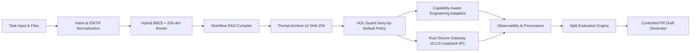

<div align="center">

<picture>
  <source media="(prefers-color-scheme: dark)" srcset="assets/brand/rei-skills-hero-dark.svg">
  <source media="(prefers-color-scheme: light)" srcset="assets/brand/rei-skills-hero-light.svg">
  
</picture>

<br/>

# REI SKILLS

**The adaptive, security-conscious engineering skill intelligence platform for AI agents.**  
*Discover. Route. Orchestrate. Verify.*

[](https://github.com/rootcastleco/rei-skills/actions/workflows/ci.yml)
[](https://rootcastleco.github.io/rei-skills/)
[](https://www.npmjs.com/package/rei-skills)
[](#explore-the-library)
[](#hybrid-semantic-skill-router--benchmark-evaluation)
[](docs/REI_REA_INTEGRATION.md)
[](docs/engineering/RUST_GATEWAY_SPEC.md)
[](LICENSE)

**[npm package](https://www.npmjs.com/package/rei-skills)** · **[Interactive Web Hub (GitHub Pages)](https://rootcastleco.github.io/rei-skills/)** · **[Publish workflow](https://github.com/rootcastleco/rei-skills/actions/workflows/publish.yml)**

**[Platform Architecture](#platform-architecture--autonomous-skill-intelligence)** · **[Quick Start](#install-in-seconds)** · **[Hybrid Router & Benchmarks](#hybrid-semantic-skill-router--benchmark-evaluation)** · **[Workflows & Adapters](#workflow-dag-compiler--capability-aware-engineering-adapters)** · **[MCP & HOL Guard](#smart-mcp-server--hol-guard-defense-in-depth)** · **[Prompt Archive & Rust Gateway](#rootcastle-prompt-intelligence-rust-gateway-v020--continuous-improvement)** · **[Explore Skills](#explore-the-library)** · **[REI REA](#rei-reverse-engineering-rei-rea)** · **[Docs & Reports](#engineering-documentation--reports)**

</div>

---

## Platform Architecture — Autonomous Skill Intelligence

**REI Skills** evolves a 1,423-skill repository into a verified, evaluated, and defense-in-depth engineering intelligence platform maintained by **[Rootcastle Engineering & Innovation](https://www.rootcastle.com)**:



<div align="center">
  
</div>

| Subsystem | Core Implementation | Verification Suite | Key Guarantee |
| :--- | :--- | :--- | :--- |
| **Hybrid Semantic Router** | [`lib/hybrid-router.js`](lib/hybrid-router.js), [`lib/smart-router.js`](lib/smart-router.js) | [`hybrid-router.test.js`](scripts/tests/hybrid-router.test.js) | Offline BM25 + 256-dim vectors, EN/TR normalization, `legacy` fallback |
| **Workflow DAG Compiler** | [`lib/workflow-compiler.js`](lib/workflow-compiler.js) | [`workflow-compiler.test.js`](scripts/tests/workflow-compiler.test.js) | Topological ordering, SI/Fusion unit checks, `claimedPhysicalExecution: false` |
| **Rootcastle Prompt Archive** | [`lib/prompt-archive.js`](lib/prompt-archive.js) | [`prompt-archive.test.js`](scripts/tests/prompt-archive.test.js) | SHA-256 verification, injection scan, offline TTL/bundled fallback |
| **HOL Guard Policy Layer** | [`lib/hol-guard-policy.js`](lib/hol-guard-policy.js), [`bin/mcp-server.js`](bin/mcp-server.js) | [`hol-guard-policy.test.js`](scripts/tests/hol-guard-policy.test.js) | Deny-by-default MCP authorization, secret redaction, traversal gates |
| **Engineering Adapters** | [`lib/engineering-adapters.js`](lib/engineering-adapters.js) | [`engineering-adapters.test.js`](scripts/tests/engineering-adapters.test.js) | Explicit capability & hardware boundaries across 5 engineering domains |
| **Rust Secure Gateway** | [`rust/rei-hook-gateway`](rust/rei-hook-gateway/) (`v0.2.0`) | `cargo test` (`7/7` passing) | Loopback IPC, replay/rate-limit/backpressure, zero shell exec, mTLS closed |
| **Observability & Self-Improvement** | [`lib/observability.js`](lib/observability.js), [`lib/evaluation-engine.js`](lib/evaluation-engine.js), [`lib/improvement-engine.js`](lib/improvement-engine.js) | [`improvement-engine.test.js`](scripts/tests/improvement-engine.test.js) | Non-regression held-out gating; review-only PR drafts (`automaticWrites: false`) |
| **Multi-AI Installer & Safe MCP Staging** | [`bin/install.js`](bin/install.js), [`lib/ai-adapters.js`](lib/ai-adapters.js), [`lib/mcp-safe-install.js`](lib/mcp-safe-install.js) | [`installer.test.js`](scripts/tests/installer.test.js), [`mcp-safe-installer.test.js`](scripts/tests/mcp-safe-installer.test.js) | 21 AI targets, transactional backup/rollback, Windows symlink safety |

---

## Install in Seconds

Install the complete **1423 validated skills** library or project focused skills into any assistant with a single command:

```bash
npx rei-skills
```

### Target Any AI Coding Assistant, IDE, or Agent SDK (`21` Targets Supported)

The **Universal Multi-AI Transpiler & Adapter Engine** ([`lib/ai-adapters.js`](lib/ai-adapters.js)) natively projects `SKILL.md` directories, Cursor `.mdc` rules, GitHub Copilot `.instructions.md` + `.prompt.md` files, Windsurf Cascade rules, Cline/RooCode/Continue/Aider/AmazonQ/Zed/Junie rules, universal `AGENTS.md` routers, and OpenAI/Anthropic/Gemini Function-Calling JSON schemas:

```bash
# CLI & IDE Skill Directories (SKILL.md + references + scripts)
npx rei-skills --claude                  # Anthropic Claude Code (~/.claude/skills)
npx rei-skills --codex                   # OpenAI Codex CLI      (~/.codex/skills)
npx rei-skills --gemini                  # Google Gemini CLI     (~/.gemini/skills)
npx rei-skills --antigravity             # Google Antigravity    (~/.gemini/rei/skills)
npx rei-skills --goose                   # Block Goose Agent     (~/.config/goose/skills)
npx rei-skills --opencode                # OpenCode Agent        (~/.agents/skills)
npx rei-skills --kiro                    # Kiro Spec-Driven IDE  (~/.kiro/skills)
npx rei-skills --amp                     # Sourcegraph Amp       (~/.config/amp/skills)

# Native IDE Rule & Prompt Transpilation (--workspace installs into current project)
npx rei-skills add rei-rea --cursor -w   # Cursor (.cursor/skills/* + .cursor/rules/*.mdc)
npx rei-skills add rei-rea --copilot -w  # GitHub Copilot (.github/instructions/*.instructions.md + prompts)
npx rei-skills add rei-rea --windsurf -w # Windsurf Cascade (.windsurf/rules/*.md)
npx rei-skills add rei-rea --cline -w    # Cline Autonomous Agent (.clinerules/*.md)
npx rei-skills add rei-rea --roocode -w  # Roo Code (.roo/rules/*.md)
npx rei-skills add rei-rea --continue -w # Continue.dev (.continue/rules/*.md)
npx rei-skills add rei-rea --aider -w    # Aider (.aider/skills/*.md + CONVENTIONS.md)
npx rei-skills add rei-rea --amazonq -w  # Amazon Q Developer (.amazonq/rules/*.md)
npx rei-skills add rei-rea --zed -w      # Zed AI (.zed/rules/*.md)
npx rei-skills add rei-rea --trae -w     # Trae AI IDE (.trae/rules/*.md)
npx rei-skills add rei-rea --junie -w    # JetBrains Junie (.junie/skills/*.md)
npx rei-skills add rei-rea --devin -w    # Cognition Devin (.devin/playbooks/*.devin.md)
npx rei-skills add rei-rea --sdk -w      # OpenAI / Anthropic / Gemini / LangGraph Tool JSON

# Configure ALL major AI assistants + generate universal AGENTS.md router at once:
npx rei-skills add rei-rea --all-ai --path ./my-project
```

### Unified CLI Quick Reference

```bash
# 1. Hybrid Intent & Stack Routing (English & Turkish + workspace file detection)
npx rei-skills recommend "Android APK ve firmware tersine mühendislik analizi" --files app.apk,router.bin

# 2. Dependency-Aware Workflow DAG Planning (computational vs hardware/CAD boundaries)
npx rei-skills plan "Design a 4-channel vibration PCB and its Fusion 360 enclosure" --files pcb.kicad_pcb,housing.step --json

# 3. Evaluate Router Performance on Held-Out Benchmark Split (train / dev / eval / all)
npx rei-skills evaluate --split eval

# 4. Inspect Capability-Aware Engineering Adapters & HOL Guard Security Status
npx rei-skills adapters --json
npx rei-skills security-status --json

# 5. Rootcastle Prompt Archive Sync, Composition & Controlled Improvement Drafts
npx rei-skills prompt sync
npx rei-skills prompt compose "Review telemetry firmware for failure modes"
npx rei-skills improve --feedback "Add SPICE bench parity cross-check" --json

# 6. Catalog Discovery, Diagnostics, MCP Server & Format Export
npx rei-skills search firmware           # Search across 1423 skills by domain, keyword, risk, or upstream source
npx rei-skills list --category reverse-engineering
npx rei-skills targets
npx rei-skills doctor
npx rei-skills mcp                       # Start stdio JSON-RPC 2.0 MCP Server
npx rei-skills export --format sdk-json --filter rei- --output ./dist-sdk
```

---

## Hybrid Semantic Skill Router & Benchmark Evaluation

Instead of injecting all 1,423 skill manuals into an agent's context window, [`lib/hybrid-router.js`](lib/hybrid-router.js) ranks relevant skills in real time using:

- **BM25 Weighted Inverted Index** (`WeakMap`-cached per catalog snapshot) paired with **256-dim offline character-trigram and domain-concept embeddings** (plus optional external `embeddingProvider` injection).
- **Bilingual EN/TR Normalization:** Turkish ASCII folding, suffix stemming, domain lexicon expansion, and boundary-matched `PHRASE_RULES`.
- **Context, Risk & Uncertainty Controls:** File extension signals (`.kicad_pcb`, `.step`, `.wasm`, `.apk`, `.tsx`, etc.), `safeOnly` risk filtering excluding `critical`/`offensive` skills, overlap detection, prerequisite domain graph hints, out-of-scope uncertainty gating (`high_uncertainty_or_out_of_scope`), and deterministic fallback (`engine: "legacy"`).

Measured across the 260-task benchmark ([`data/benchmarks/routing-benchmark-v1.json`](data/benchmarks/routing-benchmark-v1.json), split `train` = 80 / `dev` = 60 / `eval` = 120 held-out; report in [`data/benchmarks/routing-evaluation-report.json`](data/benchmarks/routing-evaluation-report.json)):

| Split | Router Engine | Recall@3 | MRR | nDCG@5 | Out-of-Scope FPR | Crit Misroute | `p95` Latency | `positive_tr` R@3 |
| :--- | :--- | ---: | ---: | ---: | ---: | ---: | ---: | ---: |
| **`train`** (80) | Legacy | 88.89% | 0.8412 | 0.7376 | 25.0% | 0 | 31.103 ms | 60.00% |
| **`train`** (80) | **Hybrid** | **98.61%** | **0.9132** | **0.8457** | **0.0%** | **0** | **3.379 ms** | **100.00%** |
| **`dev`** (60) | Legacy | 89.29% | 0.8603 | 0.7854 | 25.0% | 0 | 25.549 ms | 62.50% |
| **`dev`** (60) | **Hybrid** | **94.64%** | **0.8786** | **0.8214** | **0.0%** | **0** | **3.590 ms** | **87.50%** |
| **`eval`** (120 held-out) | Legacy | 91.07% | 0.8375 | 0.7587 | 37.5% | 0 | 26.035 ms | 70.00% |
| **`eval`** (120 held-out) | **Hybrid** | **96.43%** | **0.8897** | **0.8456** | **0.0%** | **0** | **2.919 ms** | **100.00%** |

Full breakdown: [`docs/engineering/BENCHMARK_AND_EVALUATION_REPORT.md`](docs/engineering/BENCHMARK_AND_EVALUATION_REPORT.md).

---

## Workflow DAG Compiler & Capability-Aware Engineering Adapters

### Typed Workflow Orchestration ([`lib/workflow-compiler.js`](lib/workflow-compiler.js))

For complex multi-domain requests (such as *"Design a four-channel vibration measurement PCB and its Fusion 360 enclosure"*), `compileWorkflowPlan` constructs an acyclic topological DAG with unit compatibility checks (`mm` ↔ `cm`, `kHz` ↔ `Hz`), resource budgets, retry policies, explicit uncertainty states, and strict execution boundary classifications:

- `COMPUTATIONAL_ONLY` — deterministic software planning, math, schema, and code verification.
- `REQUIRES_CAD_OR_EDA_SOFTWARE` — requires external KiCad / Fusion 360 tooling for geometry or PCB edits.
- `REQUIRES_CALIBRATED_INSTRUMENT_OR_HARDWARE` — requires physical sensors, DAQ hardware, or bench equipment.
- `REQUIRES_HUMAN_APPROVAL` — explicit operator signoff prior to manufacturing, flashing, or actuation.

Planning never fabricates physical outcomes (`executionRecord.claimedPhysicalExecution: false`).

### Capability-Aware Engineering Adapters ([`lib/engineering-adapters.js`](lib/engineering-adapters.js))

| Adapter ID | Domain | Safety Class | Computational Verifiers Implemented | External Software / Hardware Boundary |
| :--- | :--- | :--- | :--- | :--- |
| **`kicad`** | ECAD / PCB Design | `state_changing` | `planKicadVerification` (dry-run `kicad-cli` ERC/DRC plans, fab rules) | Requires `kicad-cli` on host to run actual checks; [`cad_ecad_verify.py`](scripts/cad_ecad_verify.py) |
| **`fusion360`** | MCAD / Enclosures | `state_changing` | `convertFusionUnits` (`1 cm` DB unit math), `verifyEnclosureFit` | Requires Fusion Desktop Add-In for live timeline BRep edits |
| **`embedded`** | GNSS / CAN / Firmware | `potentially_hazardous` | `validateNmeaSentence` (XOR checksum + GGA), `parseJ1939CanId` (29-bit PGN/SA) | Hardware flashing / bench telemetry requires physical target + approval |
| **`scientific`** | Physics & Optimization | `read_only` | `verifyDimensionalConsistency` (7-base SI), `evaluateOptimizationFeasibility` | Pure numerical algebra; no closed-loop lab actuation |
| **`industrial_measurement`** | Vibration & Balancing | `potentially_hazardous` | `validateSensorCalibration`, `computeVibrationFftMetrics`, `calculateSinglePlaneBalance` | Marked `COMPUTATIONAL_ONLY`; lockout/tagout & operator signoff mandatory |

### Domain Expansion Coverage (`+528` Original Engineering Skills)

- **33 Technical Specialties:** Integrated alongside the original 895 skills (`528 + 895 = 1,423`) covering GNSS, JT808 telematics, BLE, cellular IoT, RTOS, firmware OTA, IoT security, Rust, industrial Ethernet, machinery vibration, rotor balancing, DAQ, PCB/EMC, time-series pipelines, edge ML, binary forensics, HIL testing, safety assurance, and reproducible research ([`docs/TECHNICAL_SKILL_EXPANSION.md`](docs/TECHNICAL_SKILL_EXPANSION.md)).
- **128 CAD, Electronics & Fusion 360 Skills:** Circuit design, SPICE parity, KiCad ERC/DRC, Fusion 360 parametric modeling & Python API, PCB–enclosure tolerance fits, and CAM ([`docs/CAD_ELECTRONICS_FUSION.md`](docs/CAD_ELECTRONICS_FUSION.md)).
- **Quality boundary:** Passing schema and security audits does not constitute physical bench verification, metrological calibration, or standards certification; unmeasured hardware steps remain **NOT VERIFIED**.

---

## Smart MCP Server & HOL Guard Defense-in-Depth

Connect any MCP client (Claude Code, Cursor, Windsurf, Cline, Roo Code, Gemini CLI, Codex, Antigravity) to [`bin/mcp-server.js`](bin/mcp-server.js) and optionally [`rootcastleco/Rei-Reverse-engineer`](https://github.com/rootcastleco/Rei-Reverse-engineer):

```json
{
  "mcpServers": {
    "rei-skills": {
      "command": "npx",
      "args": ["-y", "rei-skills", "mcp"]
    },
    "rei-rea": {
      "command": "rei-rea",
      "args": ["mcp"]
    }
  }
}
```

### Registered MCP Tool Surface (`10` Core Tools + `3` Opt-In Extended)

- **Default Core Tools (`10`):**
  - *Policy Tier `inherit` (read / recommend / compose / compile):* `rei_recommend_skills`, `rei_search_skills`, `rei_get_skill`, `rei_get_workflow`, `rei_list_bundles`, `rei_compile_skill`, `rei_list_ai_targets`, `rei_compose_prompt`, `rei_propose_prompt_improvement`.
  - *Policy Tier `review` (staged workspace mutation):* `rei_install_skill` (`dry_run` preview, collision detection, `preview_token`, private `.rei-skills-backups/<transaction-id>/`, synchronous rollback).
- **Opt-In Extended Tools (`REI_MCP_EXTENDED_TOOLS=1`):** `rei_compile_workflow_plan`, `rei_evaluate_adapter`, `rei_security_status`.

### HOL Guard Integration & Local Policy Engine ([`lib/hol-guard-policy.js`](lib/hol-guard-policy.js))

- **Upstream Contribution:** REI Skills was contributed to Hashgraph Online's HOL Guard MCP ecosystem in [PR #7538](https://github.com/hashgraph-online/hol-guard/pull/7538) (**merged 15 Nov 2026**, schema `guard.mcp-server-contribution.v1`).
- **Local Deny-by-Default Enforcement:** `executeToolCall` routes every request and output through [`lib/hol-guard-policy.js`](lib/hol-guard-policy.js) — enforcing unknown-tool denial, prompt-injection & tool-poisoning detection, dangerous machine command blocking, credential/system path confinement (`~/.ssh`, `~/.aws`, `.npmrc`, traversal guards), supply-chain checks, and automatic API key / token output redaction.
- **Honest Runtime Disclosure:** `getHolGuardIntegrationStatus()` dynamically checks for `@hashgraphonline/hol-guard`; the external HOL Guard package is **not** installed locally in this repository by default, so local enforcement runs independently via `lib/hol-guard-policy.js` without misreporting external coverage.

---

## Rootcastle Prompt Intelligence, Rust Gateway `v0.2.0` & Continuous Improvement

- **Prompt Archive v2 ([`lib/prompt-archive.js`](lib/prompt-archive.js)):** Fetches versioned references from `https://promt.rootcastle.com/` with HTTPS allowlisting, SHA-256 `contentSha256` verification, injection scanning, language/domain tagging, incremental manifest caching, TTL expiry with `stale_offline_fallback` + `bundled_fallback`, snapshot diffing, and progressive `maxContextChars` budgeting. External prompts remain explicitly marked `UNTRUSTED_EXTERNAL_REFERENCE` and never install executable hooks or grant tool privileges.
- **Rust Secure Communication Gateway (`v0.2.0`, [`rust/rei-hook-gateway`](rust/rei-hook-gateway/)):** Typed local loopback IPC gateway (`127.0.0.1:9783`, `serde`/`serde_json`/`subtle`, zero host shell execution) enforcing constant-time token compare, `SafetyClass` gates (`read_only`, `state_changing`, `potentially_hazardous`), isolated engineering adapter contracts (`kicad`, `fusion360`, `embedded_diagnostics`, `telemetry`, `lab_equipment`), bounded nonce/timestamp replay protection, idempotent request deduplication, sliding-window rate limits, `max_in_flight` backpressure, cancellation, sanitized audit ring buffer, and fail-closed non-loopback `validate_bind_address` (`remote_enabled: false` until verified `mTLS` credentials + SAN allowlist are supplied). See [`docs/engineering/RUST_GATEWAY_SPEC.md`](docs/engineering/RUST_GATEWAY_SPEC.md).
- **Controlled Self-Improvement ([`lib/observability.js`](lib/observability.js), [`lib/evaluation-engine.js`](lib/evaluation-engine.js), [`lib/improvement-engine.js`](lib/improvement-engine.js)):** Executes sandboxed `Observe -> Detect Weakness -> Form Hypothesis -> Generate Candidate -> Test -> Compare Baseline -> Security Review -> Create PR Draft` experiments across `dev` and held-out `eval` splits, rejecting unsafe or non-beneficial mutations and outputting reviewable PR drafts with rollback plans (`automaticWrites: false`, `autoMerge: false`, `autoPublish: false`).

---

## Interactive Web Hub

Explore the searchable catalog, live Hybrid Intent & Stack Router (EN/TR), pre-compiled **Workflow DAG Preview**, **Benchmark Evaluation Dashboard**, **HOL Guard Status**, **Prompt Archive Provenance**, and **Rust Gateway** architecture on **[GitHub Pages](https://rootcastleco.github.io/rei-skills/)** or build locally via `npm run doc-site` ([`docs/site/index.html`](docs/site/index.html)).

---

## Explore the Library

The registry currently contains **1423 validated skills** across **10 engineering categories**. Counts below are synchronized directly from [`data/catalog.json`](data/catalog.json):

<!-- CATEGORY_TABLE_START -->
| Category | Count | Focus Area | Representative Skills |
| :--- | ---: | :--- | :--- |
| **Data & AI** (`data-ai`) | 243 | LLM architectures, RAG, vector databases, data pipelines, Azure AI | [`rag-engineer`](skills/rag-engineer/SKILL.md), [`langgraph`](skills/langgraph/SKILL.md), [`postgres-best-practices`](skills/postgres-best-practices/SKILL.md) |
| **General Engineering** (`general`) | 170 | Planning, technical documentation, debugging, specifications | [`brainstorming`](skills/brainstorming/SKILL.md), [`concise-planning`](skills/concise-planning/SKILL.md), [`doc-coauthoring`](skills/doc-coauthoring/SKILL.md) |
| **Software Development** (`development`) | 357 | TypeScript, Python, Go, Rust, Java, React, Next.js, mobile SDKs | [`typescript-pro`](skills/typescript-pro/SKILL.md), [`python-pro`](skills/python-pro/SKILL.md), [`react-best-practices`](skills/react-best-practices/SKILL.md) |
| **Security & AppSec** (`security`) | 144 | Threat modeling, SAST, vulnerability auditing, authorized red-teaming | [`security-auditor`](skills/security-auditor/SKILL.md), [`threat-modeling-expert`](skills/threat-modeling-expert/SKILL.md), [`api-security-best-practices`](skills/api-security-best-practices/SKILL.md) |
| **Infrastructure & Cloud** (`infrastructure`) | 149 | Kubernetes, Terraform, CI/CD, observability, SRE, service mesh | [`kubernetes-architect`](skills/kubernetes-architect/SKILL.md), [`terraform-specialist`](skills/terraform-specialist/SKILL.md), [`observability-engineer`](skills/observability-engineer/SKILL.md) |
| **Workflows & Automation** (`workflow`) | 80 | Multi-agent orchestration, task automation, integration pipelines | [`workflow-automation`](skills/workflow-automation/SKILL.md), [`mcp-builder`](skills/mcp-builder/SKILL.md), [`gitops-workflow`](skills/gitops-workflow/SKILL.md) |
| **Architecture & DDD** (`architecture`) | 99 | System design, C4 modeling, DDD, CQRS, event-driven systems | [`backend-architect`](skills/backend-architect/SKILL.md), [`domain-driven-design`](skills/domain-driven-design/SKILL.md), [`c4-context`](skills/c4-context/SKILL.md) |
| **Product & Business** (`business`) | 40 | Product management, technical SEO, pricing, GTM analysis | [`product-manager-toolkit`](skills/product-manager-toolkit/SKILL.md), [`seo-audit`](skills/seo-audit/SKILL.md), [`pricing-strategy`](skills/pricing-strategy/SKILL.md) |
| **Testing & QA** (`testing`) | 111 | Test-driven development, E2E browser automation, regression suites | [`test-driven-development`](skills/test-driven-development/SKILL.md), [`browser-automation`](skills/browser-automation/SKILL.md), [`e2e-testing-patterns`](skills/e2e-testing-patterns/SKILL.md) |
| **Reverse Engineering** (`reverse-engineering`) | 30 | Binary intelligence, firmware/IoT triage, APK/Electron/WASM, forensics | [`rei-rea-orchestrator`](skills/rei-rea-orchestrator/SKILL.md), [`rei-binary-intelligence`](skills/rei-binary-intelligence/SKILL.md), [`rei-firmware-and-iot`](skills/rei-firmware-and-iot/SKILL.md) |
<!-- CATEGORY_TABLE_END -->

- **Full Markdown Catalog:** [`CATALOG.md`](CATALOG.md)
- **Interactive Web Hub:** [`docs/site/index.html`](docs/site/index.html)
- **Curated Role Bundles:** [`docs/BUNDLES.md`](docs/BUNDLES.md) (`rei-rea`, `core-dev`, `security-core`, `k8s-core`, `data-core`, `ops-core`)
- **Execution Workflows:** [`docs/WORKFLOWS.md`](docs/WORKFLOWS.md)

---

## REI Reverse Engineering (REI REA)

REI Skills integrates the **[REI Reverse Engineering Workbench (`rootcastleco/Rei-Reverse-engineer`)](https://github.com/rootcastleco/Rei-Reverse-engineer)** as a first-class engineering module:

- **Bundled by default in `rei-skills`:** **12 specialist agent skills** (`skills/rei-*`) guiding evidence-first triage, SHA-256 artifact identity verification, format-specific inspection, and confidence tracking (`observed`, `inferred`, `unknown`).
- **Optional Python/MCP Workbench (`rootcastle-rei-rea` v0.2.0):** Standalone Python 3.10+ CLI and **14-tool local stdio MCP server** installed separately without mutating user environments automatically.

| Skill | Investigation Scope |
| :--- | :--- |
| [`rei-rea-orchestrator`](skills/rei-rea-orchestrator/SKILL.md) | Intake, SHA-256 identity, format-based routing, and verification checkpoints. |
| [`rei-binary-intelligence`](skills/rei-binary-intelligence/SKILL.md) | Bounded PE, ELF, and WebAssembly v1 structural parsing and version-to-version diffs. |
| [`rei-casebook-forensics`](skills/rei-casebook-forensics/SKILL.md) | SQLite casebook indexing, cross-case search, and metadata-only forensic bundle verification. |
| [`rei-native-binaries`](skills/rei-native-binaries/SKILL.md) | PE, ELF, Mach-O, and COFF symbol, import, ABI, and call-graph inspection. |
| [`rei-electron-and-js`](skills/rei-electron-and-js/SKILL.md) | Electron ASAR archives, preload scripts, IPC routes, and bundled JavaScript analysis. |
| [`rei-android-apks`](skills/rei-android-apks/SKILL.md) | Android APK/AAB, DEX bytecode, manifest permissions, and JNI boundary triage. |
| [`rei-firmware-and-iot`](skills/rei-firmware-and-iot/SKILL.md) | Authorized MCU, UEFI, embedded Linux, automotive telemetry, and GPS/IoT firmware analysis. |
| [`rei-mobile-runtime`](skills/rei-mobile-runtime/SKILL.md) | Authorized Android/iOS lab runtime observation planning when static evidence is insufficient. |
| [`rei-evidence-ledger`](skills/rei-evidence-ledger/SKILL.md) | Append-only SHA-256 hash-linked case records and confidence auditing. |
| [`rei-reconstruction-parity`](skills/rei-reconstruction-parity/SKILL.md) | Clean-room behavioral specifications, differential test corpora, and parity verification. |
| [`rei-wasm-and-managed`](skills/rei-wasm-and-managed/SKILL.md) | WebAssembly v1 modules, .NET CIL assemblies, and JVM bytecode analysis. |
| [`rei-web-and-protocols`](skills/rei-web-and-protocols/SKILL.md) | HAR, PCAP/PCAPNG captures, telemetry frames, and protocol state-machine reconstruction. |

👉 **Full integration guide:** [`docs/REI_REA_INTEGRATION.md`](docs/REI_REA_INTEGRATION.md) · **Reproducible demo:** [`examples/rei-rea-demo/`](examples/rei-rea-demo/README.md)

---

## Practical Demonstrations

### 1. Install the REI REA Specialist Pack and Inspect a Skill

```text
$ npx rei-skills add rei-rea --path ./.agent/skills --local

✅ REI Skills installed (12 items) to ./.agent/skills
```

```text
$ npx rei-skills info rei-rea-orchestrator

🏰 Skill: rei-rea-orchestrator (rei-rea-orchestrator)
   Category:    reverse-engineering
   Risk Level:  safe
   Provenance:  rootcastle-rei
   Path:        skills/rei-rea-orchestrator/SKILL.md
```

### 2. Inspect Harmless WebAssembly Fixtures with REI REA

```bash
rei-rea diff \
  examples/rei-rea-demo/fixtures/telemetry-filter-v1.wasm \
  examples/rei-rea-demo/fixtures/telemetry-filter-v2.wasm
```

Verified excerpt ([`examples/rei-rea-demo/DEMO_OUTPUT.json`](examples/rei-rea-demo/DEMO_OUTPUT.json)):

```json
{
  "kind": "wasm",
  "before_sha256": "a86707e622921126c88d3b27142cb9404320197c19c45ec4fb81a2a4e908949f",
  "after_sha256": "766cc87ddc6f9df8964a05f2da01e7a0c8bf8b8370b53646d57b954b5b20ba59",
  "structural_changes": {
    "imports": { "added": [{ "module": "env", "name": "audit_log_frame", "kind": 0 }], "removed": [] },
    "exports": { "added": [{ "name": "validate_packet_header", "kind": 0, "index": 3 }], "removed": [] }
  }
}
```

---

## Compatibility

Compatibility across adapters is verified via automated schema validation and installer tests ([`scripts/tests/installer.test.js`](scripts/tests/installer.test.js), [`scripts/tests/mcp-safe-installer.test.js`](scripts/tests/mcp-safe-installer.test.js), [`scripts/tests/npm-package.test.js`](scripts/tests/npm-package.test.js)):

| AI Assistant / Client | Target Directory | Installer Flag | Verification Status | Invocation Pattern |
| :--- | :--- | :--- | :--- | :--- |
| **Claude Code** | `~/.claude/skills` | `--claude` | **Tested** (Installer + YAML schema + symlink materialization) | `/skill-name` or `@skill-name` |
| **OpenAI Codex CLI** | `~/.codex/skills` | `--codex` | **Tested** (`agents/openai.yaml` metadata preserved) | `Use @skill-name ...` |
| **Gemini CLI** | `~/.gemini/skills` | `--gemini` | **Tested** (Installer + `SKILL.md` frontmatter parser) | `Use skill-name to ...` |
| **Cursor IDE** | `~/.cursor/skills` | `--cursor` | **Tested** (Installer + `.cursor/rules/*.mdc` + MCP backup) | `@skill-name` in Cursor Chat |
| **Antigravity IDE** | `~/.gemini/rei/skills` | `--antigravity` | **Tested** (Default global target + workspace `.agent/skills`) | `Use @skill-name ...` |
| **GitHub Copilot** | `.github/instructions` | `--copilot` / `export` | **Tested** (`.instructions.md` transpiler + format tests) | Attach instructions / prompt |
| **15 Additional Targets** | `.windsurf`, `.clinerules`, etc. | `--windsurf`, `--sdk`, etc. | **Tested** (`AI_TARGETS` matrix in `lib/ai-adapters.js`) | Native rule / SDK JSON |

---

## Engineering Documentation & Reports

| Document | Scope |
| :--- | :--- |
| [`docs/engineering/ARCHITECTURE.md`](docs/engineering/ARCHITECTURE.md) | End-to-end platform pipeline and ADRs `001`–`008` |
| [`docs/engineering/PHASE_A_BASELINE_REPORT.md`](docs/engineering/PHASE_A_BASELINE_REPORT.md) | Baseline audit, `npm publish` verification root-cause, and latency/FPR measurements |
| [`docs/engineering/BENCHMARK_AND_EVALUATION_REPORT.md`](docs/engineering/BENCHMARK_AND_EVALUATION_REPORT.md) | 260-task split evaluation (`Recall@3`, `MRR`, `nDCG@5`, `FPR`, `p95`) |
| [`docs/engineering/RUST_GATEWAY_SPEC.md`](docs/engineering/RUST_GATEWAY_SPEC.md) | Wire schema, isolated adapter safety classes, replay/rate-limit/backpressure & mTLS gate |
| [`docs/engineering/RELEASE_READINESS_REPORT.md`](docs/engineering/RELEASE_READINESS_REPORT.md) | Evidence-backed `PASS` / `FAIL` / `NOT VERIFIED` release readiness matrix |
| [`docs/THREAT_MODEL.md`](docs/THREAT_MODEL.md) | Platform threat model (`TM-01`–`TM-11`) and verification commands |
| [`docs/PROMPT_AUTOMATION.md`](docs/PROMPT_AUTOMATION.md) | Prompt Archive & Rust gateway operational boundary guide |
| [`docs/USAGE.md`](docs/USAGE.md) | Detailed CLI, MCP, and workflow usage guide |

---

## Contributing and Community

1. **Fork & Branch:** Create a feature branch from `main`.
2. **Add or Improve a Skill:** Follow [`docs/SKILL_ANATOMY.md`](docs/SKILL_ANATOMY.md) and [`docs/QUALITY_BAR.md`](docs/QUALITY_BAR.md).
3. **Validate Locally:**
   ```bash
   npm run validate:strict
   npm run security-audit
   npm run build
   npm test
   cargo test --manifest-path rust/rei-hook-gateway/Cargo.toml
   ```
4. **Open a Pull Request:** Follow [`.github/PULL_REQUEST_TEMPLATE.md`](.github/PULL_REQUEST_TEMPLATE.md). See also [`CONTRIBUTING.md`](CONTRIBUTING.md), [`CODE_OF_CONDUCT.md`](CODE_OF_CONDUCT.md), [`SUPPORT.md`](SUPPORT.md), and [`ROADMAP.md`](ROADMAP.md).

---

## License, Attribution, and Security

- **License:** Original code, tooling, and Rootcastle-authored skills are released under the **[MIT License](LICENSE)**.
- **Upstream Attribution & Provenance:** Preserves upstream work from `anthropics/skills`, `microsoft/skills` ([`docs/LICENSE-MICROSOFT`](docs/LICENSE-MICROSOFT)), `openai/skills`, `vercel-labs/agent-skills`, `supabase/agent-skills`, `google-gemini/gemini-skills`, and open-source contributors documented in [`CREDITS.md`](CREDITS.md) and [`docs/SOURCES.md`](docs/SOURCES.md).
- **Security Policy & Guardrails:** All 1423 skills are scanned by [`scripts/security_audit.js`](scripts/security_audit.js) and [`scripts/validate_skills.py`](scripts/validate_skills.py). Offensive security skills carry mandatory `AUTHORIZED USE ONLY` disclaimers. See [`SECURITY.md`](SECURITY.md), [`docs/SECURITY_GUARDRAILS.md`](docs/SECURITY_GUARDRAILS.md), and [`docs/THREAT_MODEL.md`](docs/THREAT_MODEL.md).

---

<div align="center">

**REI Skills — Engineering Beyond Boundaries**  
Maintained by **[Rootcastle Engineering & Innovation](https://www.rootcastle.com)** · Batuhan Ayrıbaş · [admin@rootcastle.com](mailto:admin@rootcastle.com)  
[Project overview](https://rootcastle.com/en/projects/rei-skills/) · [Engineering walkthrough](https://rootcastle.com/en/engineering-notes/evidence-based-reverse-engineering/)

</div>
