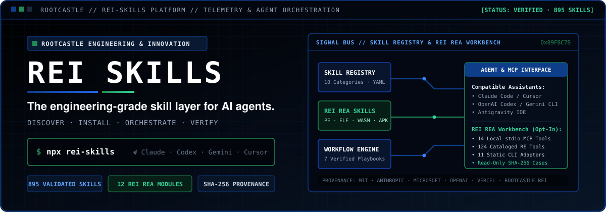
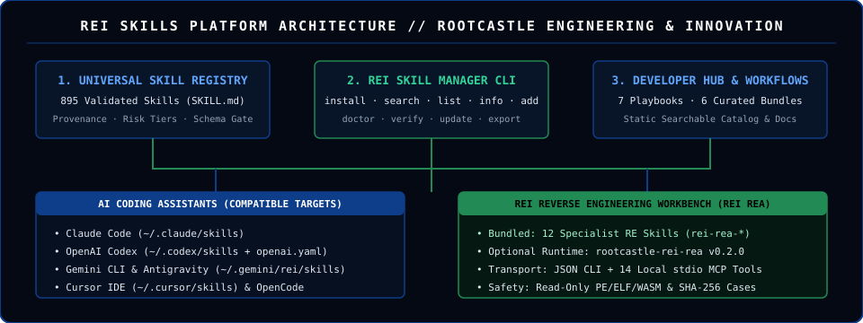

<div align="center">

<picture>
  <source media="(prefers-color-scheme: dark)" srcset="assets/brand/rei-skills-hero-dark.svg">
  <source media="(prefers-color-scheme: light)" srcset="assets/brand/rei-skills-hero-light.svg">
  
</picture>

<br/>

# REI SKILLS

**The engineering-grade skill layer for AI agents.**  
*Discover. Install. Orchestrate. Verify.*

[](https://github.com/rootcastleco/rei-skills/actions/workflows/ci.yml)
[](https://rootcastleco.github.io/rei-skills/)
[](https://www.npmjs.com/package/rei-skills)
[](#explore-the-library)
[](docs/REI_REA_INTEGRATION.md)
[](LICENSE)

**[Get Started](#install-in-seconds)** · **[Smart Router & MCP](#smart-skill-router--mcp-server)** · **[Live Web Hub (GitHub Pages)](https://rootcastleco.github.io/rei-skills/)** · **[Explore Skills](#explore-the-library)** · **[REI REA](#rei-reverse-engineering-rei-rea)** · **[Documentation](docs/USAGE.md)** · **[Contribute](#contributing-and-community)**

</div>

---

## Install in Seconds

Install the complete skill library or target a specific coding assistant with a single command:

```bash
npx rei-skills
```

### Target Any AI Coding Assistant, IDE, or Agent SDK (`21` Targets Supported)

REI Skills includes a built-in **Universal Multi-AI Transpiler & Adapter Engine** ([`lib/ai-adapters.js`](lib/ai-adapters.js)) that natively supports `SKILL.md` directories, Cursor `.mdc` rules, GitHub Copilot `.instructions.md` + `.prompt.md` files, Windsurf Cascade rules, Cline/RooCode/Continue/Aider/AmazonQ/Zed/Junie rules, universal `AGENTS.md` routers, and OpenAI/Anthropic/Gemini Function-Calling JSON schemas:

```bash
# CLI & IDE Skill Directories (SKILL.md + references + scripts)
npx rei-skills --claude                  # Anthropic Claude Code (~/.claude/skills)
npx rei-skills --codex                   # OpenAI Codex CLI      (~/.codex/skills)
npx rei-skills --gemini                  # Google Gemini CLI     (~/.gemini/skills)
npx rei-skills --antigravity             # Google Antigravity    (~/.gemini/rei/skills)
npx rei-skills --goose                   # Block Goose Agent     (~/.config/goose/skills)
npx rei-skills --opencode                # OpenCode Agent        (~/.agents/skills)
npx rei-skills --kiro                    # Kiro Spec-Driven IDE  (~/.kiro/skills)
npx rei-skills --amp                     # Sourcegraph Amp       (~/.config/amp/skills)

# Native IDE Rule & Prompt Transpilation (--workspace installs into current project)
npx rei-skills add rei-rea --cursor -w   # Cursor (.cursor/skills/* + .cursor/rules/*.mdc)
npx rei-skills add rei-rea --copilot -w  # GitHub Copilot (.github/instructions/*.instructions.md + prompts)
npx rei-skills add rei-rea --windsurf -w # Windsurf Cascade (.windsurf/rules/*.md)
npx rei-skills add rei-rea --cline -w    # Cline Autonomous Agent (.clinerules/*.md)
npx rei-skills add rei-rea --roocode -w  # Roo Code (.roo/rules/*.md)
npx rei-skills add rei-rea --continue -w # Continue.dev (.continue/rules/*.md)
npx rei-skills add rei-rea --aider -w    # Aider (.aider/skills/*.md + CONVENTIONS.md)
npx rei-skills add rei-rea --amazonq -w  # Amazon Q Developer (.amazonq/rules/*.md)
npx rei-skills add rei-rea --zed -w      # Zed AI (.zed/rules/*.md)
npx rei-skills add rei-rea --trae -w     # Trae AI IDE (.trae/rules/*.md)
npx rei-skills add rei-rea --junie -w    # JetBrains Junie (.junie/skills/*.md)
npx rei-skills add rei-rea --devin -w    # Cognition Devin (.devin/playbooks/*.devin.md)
npx rei-skills add rei-rea --sdk -w      # OpenAI / Anthropic / Gemini / LangGraph Tool JSON

# Configure ALL major AI assistants + generate universal AGENTS.md router at once:
npx rei-skills add rei-rea --all-ai --path ./my-project
```

### Immediate Next Steps

```bash
# 1. Smart Intent & Stack Router (English & Turkish + workspace file detection)
npx rei-skills recommend "Reverse engineer Android APK and firmware" --files app.apk,router.bin

# 2. Start the built-in Smart Skill Management MCP Server (stdio JSON-RPC 2.0)
npx rei-skills mcp

# 3. View all 21 supported AI assistants, native formats, and invocation hints
npx rei-skills targets

# 4. Inspect your environment, installed AI directories, and REI REA status
npx rei-skills doctor

# 5. Search across 895 skills by domain, keyword, risk, or upstream source
npx rei-skills search firmware
npx rei-skills list --category reverse-engineering

# 6. Install only a focused bundle or compile to any target format
npx rei-skills add rei-rea --claude --print-mcp
npx rei-skills export --format sdk-json --filter rei- --output ./dist-sdk
```

### Smart Skill Router & MCP Server

Instead of loading all 895 skills into an AI agent's context window, REI Skills includes a **Smart Intent & Stack Router** ([`lib/smart-router.js`](lib/smart-router.js)) and a zero-dependency **Model Context Protocol (MCP) Server** ([`bin/mcp-server.js`](bin/mcp-server.js)) that any MCP-capable client (Claude Code, Cursor, Windsurf, Cline, Roo Code, Gemini CLI, Codex, Antigravity) can connect to:

```json
{
  "mcpServers": {
    "rei-skills": {
      "command": "npx",
      "args": ["-y", "rei-skills", "mcp"]
    },
    "rei-rea": {
      "command": "rei-rea",
      "args": ["mcp"]
    }
  }
}
```

- **8 Dynamic MCP Tools:** `rei_recommend_skills`, `rei_search_skills`, `rei_get_skill`, `rei_get_workflow`, `rei_list_bundles`, `rei_install_skill`, `rei_compile_skill`, `rei_list_ai_targets`.

#### Safe MCP skill installation

`rei_install_skill` stages the requested skill(s) outside the workspace and checks **every target file** before making changes. Unlike the earlier direct-write MCP path, it now supports a read-only workspace preview, explicit conflict policy, SHA-256 change detection, backups, and synchronous rollback:

1. Preview: `{"target_name":"rei-rea-orchestrator","ai_assistant":"cursor","workspace_path":"/path/to/existing-project","dry_run":true}`. The result includes file counts, collisions, `canInstall`, and a `previewToken`. Preview does not change the target workspace.
2. For a fresh install without conflicts, call the tool without `dry_run` (default `conflict_policy="abort"`).
3. If files already exist, preview again with `"conflict_policy":"backup","dry_run":true`; inspect replacements and then call with `"conflict_policy":"backup","preview_token":"<exact previewToken>"`. Any modified destination invalidates the token and requires a new preview.
4. The installer copies original files into `<workspace>/.rei-skills-backups/<transaction-id>/` with a JSON manifest before replacing them. It automatically restores touched files when a synchronous install fails. Interrupted process/power loss requires recovery from the preserved backup; installation across multiple files is **not** a filesystem-atomic transaction.

Safety boundaries: existing workspaces only; unknown skill IDs and symlinks in destination paths are rejected; generated `AGENTS.md`, Cursor rules, and Copilot prompts are included in the same preflight. This intentionally rejects legacy silent overwrites: clients that update existing skills must opt into explicit backup mode.

- **Interactive Web Hub:** Try the live **Smart AI Task & Stack Router** in your browser at **[`https://rootcastleco.github.io/rei-skills/`](https://rootcastleco.github.io/rei-skills/)**.

---

## Why REI Skills?

AI coding assistants perform best when given structured domain procedures, explicit boundaries, and verifiable checklists rather than ad-hoc prompts. **REI Skills** provides an indexed, schema-validated skill layer maintained by **[Rootcastle Engineering & Innovation](https://www.rootcastle.com)**.

| Capability | Engineering Implementation |
| :--- | :--- |
| **Universal `SKILL.md` Standard** | Every skill is validated for YAML frontmatter integrity, trigger rules (`## When to Use`), risk classification, and local reference links. |
| **Safe, Non-Destructive CLI Manager** | `bin/install.js` verifies repository ownership before migrating legacy installs, creates backups, supports `--dry-run`, and materializes symlinks on Windows without Administrator privileges. |
| **Compatibility Projection** | `npx rei-skills export --agent <target> --out <dir>` projects skills into narrow frontmatter schemas while preserving `agents/openai.yaml` and reference files. |
| **Curated Bundles & Workflows** | Role-based skill bundles ([`docs/BUNDLES.md`](docs/BUNDLES.md)) and multi-step execution playbooks ([`docs/WORKFLOWS.md`](docs/WORKFLOWS.md)) coordinate complex engineering tasks. |
| **Evidence-First Reverse Engineering** | First-class integration with **[REI REA](https://github.com/rootcastleco/Rei-Reverse-engineer)**: 12 specialist reverse-engineering skills plus an optional Python CLI and 14-tool local stdio MCP server. |
| **Transparent Provenance & Risk Tiers** | Every skill declares its `risk` (`none`, `safe`, `critical`, `offensive`) and upstream `source` (`rootcastle-rei`, `microsoft/skills`, `anthropics/skills`, `openai/skills`, `vercel-labs/agent-skills`, or community). |

---

## The Ecosystem

<div align="center">
  
</div>

REI Skills connects five platform components:

1. **Universal Skill Registry (`skills/`, `data/catalog.json`):** 895 categorized, schema-checked skills with progressive reference loading (`references/`, `scripts/`, `examples/`).
2. **REI Skill Manager (`bin/install.js`):** Cross-platform CLI for installing, searching, inspecting, verifying, and exporting skills.
3. **Workflow Engine (`data/workflows.json`, `docs/WORKFLOWS.md`):** Structured playbooks that sequence multiple compatible skills for SaaS delivery, AppSec auditing, agent engineering, DDD modeling, and reverse engineering.
4. **REI Reverse Engineering (`skills/rei-*`, `data/rei-rea-manifest.json`):** 12 specialist reverse-engineering skills synchronized from `rootcastleco/Rei-Reverse-engineer` (`v0.2.0 @ 09fbc7b`), with optional connection to the local `rei-rea` CLI/MCP workbench.
5. **Developer Hub (`CATALOG.md`, `docs/site/index.html`):** Offline-capable static search interface and contributor documentation.

---

## Explore the Library

The registry currently contains **895 validated skills** across **10 engineering categories**. Counts below are generated directly from [`data/catalog.json`](data/catalog.json):

<!-- CATEGORY_TABLE_START -->
| Category | Count | Focus Area | Representative Skills |
| :--- | ---: | :--- | :--- |
| **Data & AI** (`data-ai`) | 163 | LLM architectures, RAG, vector databases, data pipelines, Azure AI | [`rag-engineer`](skills/rag-engineer/SKILL.md), [`langgraph`](skills/langgraph/SKILL.md), [`postgres-best-practices`](skills/postgres-best-practices/SKILL.md) |
| **General Engineering** (`general`) | 154 | Planning, technical documentation, debugging, specifications | [`brainstorming`](skills/brainstorming/SKILL.md), [`concise-planning`](skills/concise-planning/SKILL.md), [`doc-coauthoring`](skills/doc-coauthoring/SKILL.md) |
| **Software Development** (`development`) | 133 | TypeScript, Python, Go, Rust, Java, React, Next.js, mobile SDKs | [`typescript-pro`](skills/typescript-pro/SKILL.md), [`python-pro`](skills/python-pro/SKILL.md), [`react-best-practices`](skills/react-best-practices/SKILL.md) |
| **Security & AppSec** (`security`) | 112 | Threat modeling, SAST, vulnerability auditing, authorized red-teaming | [`security-auditor`](skills/security-auditor/SKILL.md), [`threat-modeling-expert`](skills/threat-modeling-expert/SKILL.md), [`api-security-best-practices`](skills/api-security-best-practices/SKILL.md) |
| **Infrastructure & Cloud** (`infrastructure`) | 101 | Kubernetes, Terraform, CI/CD, observability, SRE, service mesh | [`kubernetes-architect`](skills/kubernetes-architect/SKILL.md), [`terraform-specialist`](skills/terraform-specialist/SKILL.md), [`observability-engineer`](skills/observability-engineer/SKILL.md) |
| **Workflows & Automation** (`workflow`) | 80 | Multi-agent orchestration, task automation, integration pipelines | [`workflow-automation`](skills/workflow-automation/SKILL.md), [`mcp-builder`](skills/mcp-builder/SKILL.md), [`gitops-workflow`](skills/gitops-workflow/SKILL.md) |
| **Architecture & DDD** (`architecture`) | 67 | System design, C4 modeling, DDD, CQRS, event-driven systems | [`backend-architect`](skills/backend-architect/SKILL.md), [`domain-driven-design`](skills/domain-driven-design/SKILL.md), [`c4-context`](skills/c4-context/SKILL.md) |
| **Product & Business** (`business`) | 40 | Product management, technical SEO, pricing, GTM analysis | [`product-manager-toolkit`](skills/product-manager-toolkit/SKILL.md), [`seo-audit`](skills/seo-audit/SKILL.md), [`pricing-strategy`](skills/pricing-strategy/SKILL.md) |
| **Testing & QA** (`testing`) | 31 | Test-driven development, E2E browser automation, regression suites | [`test-driven-development`](skills/test-driven-development/SKILL.md), [`browser-automation`](skills/browser-automation/SKILL.md), [`e2e-testing-patterns`](skills/e2e-testing-patterns/SKILL.md) |
| **Reverse Engineering** (`reverse-engineering`) | 14 | Binary intelligence, firmware/IoT triage, APK/Electron/WASM, forensics | [`rei-rea-orchestrator`](skills/rei-rea-orchestrator/SKILL.md), [`rei-binary-intelligence`](skills/rei-binary-intelligence/SKILL.md), [`rei-firmware-and-iot`](skills/rei-firmware-and-iot/SKILL.md) |
<!-- CATEGORY_TABLE_END -->

- **Full Markdown Catalog:** [`CATALOG.md`](CATALOG.md)
- **Interactive Searchable Catalog:** [`docs/site/index.html`](docs/site/index.html)
- **Curated Role Bundles:** [`docs/BUNDLES.md`](docs/BUNDLES.md) (`rei-rea`, `core-dev`, `security-core`, `k8s-core`, `data-core`, `ops-core`)
- **Execution Workflows:** [`docs/WORKFLOWS.md`](docs/WORKFLOWS.md)

---

## REI Reverse Engineering (REI REA)

REI Skills integrates the **[REI Reverse Engineering Workbench (`rootcastleco/Rei-Reverse-engineer`)](https://github.com/rootcastleco/Rei-Reverse-engineer)** as a first-class engineering module.

### Architectural Separation: Bundled Guidance vs. Optional Workbench

- **Included by default in `rei-skills`:** **12 specialist agent skills** (`skills/rei-*`) that guide AI assistants through evidence-first triage, SHA-256 artifact identity verification, format-specific analysis, and confidence tracking (`observed`, `inferred`, `unknown`).
- **Optional Python/MCP Workbench (`rootcastle-rei-rea` v0.2.0):** A standalone, dependency-free Python 3.10+ CLI and **14-tool local stdio MCP server** installed separately from [`rootcastleco/Rei-Reverse-engineer`](https://github.com/rootcastleco/Rei-Reverse-engineer). Installing `rei-skills` never silently installs Python packages or executes external binaries.

### The 12 Specialist REI REA Skills

| Skill | Investigation Scope |
| :--- | :--- |
| [`rei-rea-orchestrator`](skills/rei-rea-orchestrator/SKILL.md) | Intake, SHA-256 identity, format-based routing, and verification checkpoints. |
| [`rei-binary-intelligence`](skills/rei-binary-intelligence/SKILL.md) | Bounded PE, ELF, and WebAssembly v1 structural parsing and version-to-version diffs. |
| [`rei-casebook-forensics`](skills/rei-casebook-forensics/SKILL.md) | SQLite casebook indexing, cross-case search, and metadata-only forensic bundle verification. |
| [`rei-native-binaries`](skills/rei-native-binaries/SKILL.md) | PE, ELF, Mach-O, and COFF symbol, import, ABI, and call-graph inspection. |
| [`rei-electron-and-js`](skills/rei-electron-and-js/SKILL.md) | Electron ASAR archives, preload scripts, IPC routes, and bundled JavaScript analysis. |
| [`rei-android-apks`](skills/rei-android-apks/SKILL.md) | Android APK/AAB, DEX bytecode, manifest permissions, and JNI boundary triage. |
| [`rei-firmware-and-iot`](skills/rei-firmware-and-iot/SKILL.md) | Authorized MCU, UEFI, embedded Linux, automotive telemetry, and GPS/IoT firmware analysis. |
| [`rei-mobile-runtime`](skills/rei-mobile-runtime/SKILL.md) | Authorized Android/iOS lab runtime observation planning when static evidence is insufficient. |
| [`rei-evidence-ledger`](skills/rei-evidence-ledger/SKILL.md) | Append-only SHA-256 hash-linked case records and confidence auditing. |
| [`rei-reconstruction-parity`](skills/rei-reconstruction-parity/SKILL.md) | Clean-room behavioral specifications, differential test corpora, and parity verification. |
| [`rei-wasm-and-managed`](skills/rei-wasm-and-managed/SKILL.md) | WebAssembly v1 modules, .NET CIL assemblies, and JVM bytecode analysis. |
| [`rei-web-and-protocols`](skills/rei-web-and-protocols/SKILL.md) | HAR, PCAP/PCAPNG captures, telemetry frames, and protocol state-machine reconstruction. |

### Accurate Capability States (REI REA v0.2.0)

| Capability State | Scope in v0.2.0 | Verification Boundary |
| :--- | :--- | :--- |
| **Cataloged (`124` tools)** | Metadata records in `tools.json` with tags and homepages. | Discovery only; does **not** imply local installation or execution. |
| **PATH-Detected** | Local executable probing via `rei-rea tools doctor`. | Confirms binary name on `PATH`; does not verify version or license. |
| **Adapter-Supported (`11` tools)** | `file`, `readelf`, `objdump`, `llvm-objdump`, `llvm-readobj`, `nm`, `exiftool`, `otool`, `aapt2`, `rabin2`, `rz-bin`. | Requires local binary + explicit `--allow-external` flag; runs without a shell. |
| **Built-In Tested** | Bounded PE, ELF, and WebAssembly v1 parsers, SHA-256 cases, SQLite casebook, 14 MCP tools. | Read-only stdlib implementation tested on Linux, macOS, and Windows. |
| **Planned** | Live Ghidra/IDA/JADX/Frida session providers; upstream `morluto/rea` adapter. | Documented roadmap items; not active in v0.2.0. |

👉 **Read the full integration guide:** [`docs/REI_REA_INTEGRATION.md`](docs/REI_REA_INTEGRATION.md) · **Run the reproducible demo:** [`examples/rei-rea-demo/`](examples/rei-rea-demo/README.md)

---

## Practical Demonstrations

### 1. Install the REI REA Specialist Pack and Inspect a Skill

```text
$ npx rei-skills add rei-rea --path ./.agent/skills --local

✅ REI Skills installed (12 items) to ./.agent/skills
🔌 Optional REI REA Runtime & MCP Workbench Setup:
   Skills are read-only agent instructions. To enable the optional local Python CLI & 14-tool MCP server:
     git clone https://github.com/rootcastleco/Rei-Reverse-engineer.git
     cd Rei-Reverse-engineer && python -m pip install -e .
     rei-rea tools doctor
```

```text
$ npx rei-skills info rei-rea-orchestrator

🏰 Skill: rei-rea-orchestrator (rei-rea-orchestrator)
   Category:    reverse-engineering
   Risk Level:  safe
   Provenance:  rootcastle-rei
   Path:        skills/rei-rea-orchestrator/SKILL.md
   Tags:        reverse-engineering, binary-analysis, orchestrator, mcp, rei-rea, triage
   Description: Route authorized reverse-engineering investigations across binaries, APKs, Electron, firmware, and WASM using REI REA.
   Files:       agents/openai.yaml, references/QUICKSTART.md, references/workflow.md, scripts/doctor.py, SKILL.md
   REI REA:     Specialist Reverse-Engineering Skill (Upstream SHA-256: 9f50e748bcad…)
```

### 2. Coordinate an Engineering Workflow in Your Agent

Invoke skills directly in Claude Code, Cursor, Codex, Gemini CLI, or Antigravity:

```text
# SaaS Architecture & Implementation Workflow
Use @concise-planning and @backend-architect to define the API contract and PostgreSQL schema for our multi-tenant telemetry ingestion service, then validate query indexing with @postgres-best-practices.

# Evidence-Led Reverse Engineering Workflow
Use @rei-rea-orchestrator and @rei-binary-intelligence to inspect examples/rei-rea-demo/fixtures/telemetry-filter-v2.wasm, compare it against telemetry-filter-v1.wasm, and record observed structural differences.
```

### 3. Inspect and Diff Harmless WebAssembly Fixtures with REI REA

Using the redistributable fixtures in [`examples/rei-rea-demo/fixtures/`](examples/rei-rea-demo/README.md) with the optional `rei-rea` CLI installed:

```bash
rei-rea diff \
  examples/rei-rea-demo/fixtures/telemetry-filter-v1.wasm \
  examples/rei-rea-demo/fixtures/telemetry-filter-v2.wasm
```

Verified output excerpt ([`examples/rei-rea-demo/DEMO_OUTPUT.json`](examples/rei-rea-demo/DEMO_OUTPUT.json)):

```json
{
  "kind": "wasm",
  "before_sha256": "a86707e622921126c88d3b27142cb9404320197c19c45ec4fb81a2a4e908949f",
  "after_sha256": "766cc87ddc6f9df8964a05f2da01e7a0c8bf8b8370b53646d57b954b5b20ba59",
  "structural_changes": {
    "imports": {
      "added": [
        { "module": "env", "name": "audit_log_frame", "kind": 0 }
      ],
      "removed": []
    },
    "exports": {
      "added": [
        { "name": "validate_packet_header", "kind": 0, "index": 3 }
      ],
      "removed": []
    }
  }
}
```

---

## Compatibility

Compatibility claims in REI Skills are backed by automated schema validation and installer verification (`scripts/tests/installer.test.js`):

| AI Assistant / Client | Target Directory | Installer Flag | Verification Status | Invocation Pattern |
| :--- | :--- | :--- | :--- | :--- |
| **Claude Code** | `~/.claude/skills` | `--claude` | **Tested** (Installer + YAML schema + symlink materialization) | `/skill-name` or `@skill-name` |
| **OpenAI Codex CLI** | `~/.codex/skills` | `--codex` | **Tested** (Includes `agents/openai.yaml` metadata in REI REA skills) | `Use @skill-name ...` |
| **Gemini CLI** | `~/.gemini/skills` | `--gemini` | **Tested** (Installer + `SKILL.md` frontmatter parser) | `Use skill-name to ...` |
| **Cursor IDE** | `~/.cursor/skills` | `--cursor` | **Tested** (Installer + MCP config backup generator) | `@skill-name` in Cursor Chat |
| **Antigravity IDE** | `~/.gemini/rei/skills` | `--antigravity` | **Tested** (Default global target + workspace `.agent/skills`) | `Use @skill-name ...` |
| **OpenCode CLI** | `.agents/skills` | `--path .agents/skills` | **Documented** (`SKILL.md` standard compatible) | `opencode run @skill-name` |
| **GitHub Copilot** | Workspace files | `export --agent copilot` | **Documented** (Manual context attachment or projected markdown) | Attach `SKILL.md` in chat |

---

## Contributing and Community

We welcome new skills, quality improvements, reference updates, and workflow playbooks!

1. **Fork & Branch:** Create a feature branch from `main`.
2. **Add or Improve a Skill:** Create `skills/<your-skill-name>/SKILL.md` following [`docs/SKILL_ANATOMY.md`](docs/SKILL_ANATOMY.md) and [`docs/QUALITY_BAR.md`](docs/QUALITY_BAR.md).
3. **Validate Locally:**
   ```bash
   npm run validate:strict
   npm run security-audit
   npm run build
   npm test
   ```
4. **Open a Pull Request:** Follow the checklist in [`.github/PULL_REQUEST_TEMPLATE.md`](.github/PULL_REQUEST_TEMPLATE.md).

See [`CONTRIBUTING.md`](CONTRIBUTING.md), [`CODE_OF_CONDUCT.md`](CODE_OF_CONDUCT.md), [`SUPPORT.md`](SUPPORT.md), and [`ROADMAP.md`](ROADMAP.md) for full details.

---

## License, Attribution, and Security

- **License:** Original code, tooling, and Rootcastle-authored skills (including the 12 REI REA skills) are released under the **[MIT License](LICENSE)**.
- **Upstream Attribution & Provenance:** REI Skills curates and preserves work from official vendor repositories (`anthropics/skills`, `microsoft/skills` — see [`docs/LICENSE-MICROSOFT`](docs/LICENSE-MICROSOFT) and [`docs/microsoft-skills-attribution.json`](docs/microsoft-skills-attribution.json), `openai/skills`, `vercel-labs/agent-skills`, `supabase/agent-skills`, `google-gemini/gemini-skills`) and open-source contributors (`sickn33/antigravity-awesome-skills`, `rmyndharis/antigravity-skills`, `obra/superpowers`, `trailofbits/skills`, `getsentry/skills`, and others). Full credits are documented in **[`CREDITS.md`](CREDITS.md)** and **[`docs/SOURCES.md`](docs/SOURCES.md)**.
- **Security Policy & Guardrails:** All 895 skills are scanned by [`scripts/security_audit.js`](scripts/security_audit.js) and [`scripts/validate_skills.py`](scripts/validate_skills.py). Offensive security skills carry mandatory `AUTHORIZED USE ONLY` disclaimers. See **[`SECURITY.md`](SECURITY.md)**, **[`docs/SECURITY_GUARDRAILS.md`](docs/SECURITY_GUARDRAILS.md)**, and **[`docs/THREAT_MODEL.md`](docs/THREAT_MODEL.md)**.

---

<div align="center">

**REI Skills — Engineering Beyond Boundaries**  
Maintained by **[Rootcastle Engineering & Innovation](https://www.rootcastle.com)** · Batuhan Ayrıbaş · [admin@rootcastle.com](mailto:admin@rootcastle.com)

</div>

## Rootcastle project guide

[Project overview and practical workflow](https://rootcastle.com/en/projects/rei-skills/) · [Engineering walkthrough](https://rootcastle.com/en/engineering-notes/evidence-based-reverse-engineering/)

The repository remains the reference for current setup, supported features and licensing. The project guide explains the workflow and its verification boundaries.
