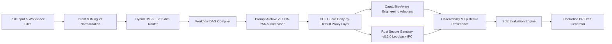

# REI Skills — Platform Architecture & Integration Specification

**Organization:** Rootcastle Engineering & Innovation (REI)  
**Positioning:** *The engineering-grade skill layer for AI agents.*

---

## 1. Platform Overview

REI Skills is structured around five distinct, modular capabilities with explicit dependency and security boundaries:

```text
                       REI SKILLS
                  Rootcastle Platform
                           |
       +-------------------+-------------------+
       |                   |                   |
  Skill Registry      Skill Manager        Developer Hub
       |                   |                   |
  Discovery/Index     Install/Update        Documentation
  Metadata            Verification          Search
  Quality Checks      Compatibility         Examples
       |                   |                   |
       +-------------------+-------------------+
                           |
                    Workflow Engine
                           |
           +---------------+---------------+
           |                               |
      General Skills                 REI REA Skills
           |                               |
     Coding / DevOps                 Reverse Engineering
     AI / Data                       Digital Forensics
     Security                        Firmware / IoT
     Engineering                     Binary Intelligence
                                           |
                                  Optional REI REA Adapter
                                           |
                                 Versioned CLI / MCP Interface
                                           |
                                 REI Reverse Engineering
                                        Workbench
```

### 1.1 Universal Skill Library (`skills/`, `data/catalog.json`, `skills_index.json`)
- **Single Source of Truth:** Every skill resides in `skills/<skill-id>/SKILL.md` with optional `references/`, `scripts/`, `examples/`, and `agents/` subdirectories for progressive disclosure.
- **Canonical Frontmatter Contract:**
  - `name`: Kebab-case identifier matching directory name.
  - `description`: Action-oriented summary for agent trigger routing.
  - `risk`: `none` | `safe` | `critical` | `offensive` | `unknown`.
  - `source`: Upstream provenance (`rootcastle-rei`, `microsoft/skills`, `anthropics/skills`, `openai/skills`, `vercel-labs/agent-skills`, `supabase/agent-skills`, `community`, etc.).
  - `curated_by`: `rootcastle-rei` (preserves Rootcastle curation metadata without overwriting upstream authorship).
- **Compatibility Projection (`rei-skills export`):** Generates target-specific skill trees for clients that enforce strict/narrow frontmatter schemas (e.g., stripping extended registry fields or generating `agents/openai.yaml`).

### 1.2 REI Skill Manager (`bin/install.js`, `lib/skill-utils.js`)
- **Zero-Runtime-Dependency Node CLI:** Ships inside the npm package (`bin/install.js` + `lib/` + `data/rei-rea-manifest.json`) so `npx rei-skills` works reliably across Windows, macOS, and Linux.
- **Supported Commands:**
  - `npx rei-skills [install]` — Default installation (global or target-specific via `--claude`, `--gemini`, `--cursor`, `--codex`, `--antigravity`, `--path <dir>`).
  - `rei-skills list [--category <cat>] [--bundle <bundle>] [--source <src>] [--json]` — Lists available or installed skills.
  - `rei-skills search <query> [--category <cat>] [--risk <risk>] [--json]` — Searches across IDs, names, descriptions, tags, and triggers.
  - `rei-skills info <skill-id> [--json]` — Displays detailed metadata, provenance, risk level, and file inventory for a skill.
  - `rei-skills add <skill-id|bundle|rei-rea> [options]` — Installs an individual skill, bundle, or the 12 REI REA specialist skills (with optional `--mcp-config` generation).
  - `rei-skills doctor [--json]` — Inspects local environment (Git, Node, Python, agent skill directories, and optional `rei-rea` workbench availability).
  - `rei-skills verify [--path <dir>] [--strict]` — Verifies skill schema, frontmatter, and reference integrity.
  - `rei-skills update [options]` — Safely updates an existing installation with backup and rollback protection.
  - `rei-skills export --agent <claude|codex|gemini|cursor|antigravity> --out <dir>` — Projects skills into agent-specific compatibility layouts.

### 1.3 REI Workflows (`data/workflows.json`, `docs/WORKFLOWS.md`)
- Multi-step engineering playbooks that coordinate compatible skills in sequence with explicit inputs, outputs, and verification gates:
  - Ship a SaaS MVP
  - Security Audit for a Web App
  - Build an AI Agent System
  - QA and Browser Automation
  - Evidence-Led Reverse Engineering (`rei-rea-orchestrator` -> `rei-binary-intelligence` -> `rei-evidence-ledger` -> `rei-casebook-forensics`)
  - Firmware & Binary Version Triage (`rei-firmware-and-iot` -> `rei-native-binaries` -> `rei-reconstruction-parity`)

### 1.4 REI Reverse Engineering Integration (`data/rei-rea-manifest.json`, `scripts/sync_rei_rea.py`)
- **Authoritative Separation:** `https://github.com/rootcastleco/Rei-Reverse-engineer` remains the authoritative repository for the `rootcastle-rei-rea` Python runtime, CLI, and 14-tool stdio MCP server.
- **Managed Skill Synchronization:** The 12 specialist REI REA skills are distributed in `skills/rei-*` and tracked via `data/rei-rea-manifest.json` with pinned upstream commit hash (`09fbc7b`), version (`0.2.0`), and per-skill SHA-256 content digests.
- **Opt-In Runtime Adapter:** Normal skill installation (`npx rei-skills`) installs Markdown instructions and reference files only. It never silently installs Python packages, external reverse-engineering binaries, or modifies MCP configs. Users explicitly opt in via `pip install -e .` (from `Rei-Reverse-engineer`) and `rei-skills add rei-rea --print-mcp`.

### 1.5 REI Developer Experience (`README.md`, `CATALOG.md`, `docs/site/index.html`)
- **Static Searchable Catalog (`docs/site/index.html`):** Generated from `data/catalog.json` during `npm run build` (`scripts/build-doc-site.js`), providing zero-backend instant search, category/risk/source filtering, bundle browsing, and copy-paste installation commands.

---

## 2. Architectural Decision Records (ADRs)

### ADR-001: Hybrid Managed Import for REI REA Integration
- **Context:** We evaluated six integration models for `rootcastleco/Rei-Reverse-engineer`: (1) Git submodule, (2) Git subtree, (3) npm Python dependency, (4) Manifest-driven managed skill import + optional runtime adapter, (5) Release artifact download during install, (6) Full repository merge.
- **Decision:** Model 4 — **Manifest-driven managed skill import (`data/rei-rea-manifest.json` + `scripts/sync_rei_rea.py`) paired with an optional CLI/MCP runtime adapter in `bin/install.js`**.
- **Consequences:**
  - Users of `npx rei-skills` immediately get all 12 specialist reverse-engineering skills without needing Python or submodules during clone.
  - `Rei-Reverse-engineer` retains its independent Python packaging (`pyproject.toml`), test suite, and `upstream/rea` (`morluto/rea`) gitlink sync workflow without interference.
  - Every sync is deterministic, hash-verified, and reversible.

### ADR-002: Safe Migration & Symlink Materialization in Installer
- **Context:** Previous versions of `bin/install.js` deleted any target directory containing `.git` and relied on `git -c core.symlinks=true clone` on Windows.
- **Decision:**
  1. Never delete a `.git` directory unless `git config --get remote.origin.url` matches `rei-skills` or `antigravity-awesome-skills`, and even then create a timestamped backup directory before migrating.
  2. Materialize intra-repository skill symlinks (`docx -> docx-official`, `pdf -> pdf-official`, `pptx -> pptx-official`, `xlsx -> xlsx-official`) into real directories when copying to target paths so Windows users do not need Administrator privileges or Developer Mode.

### ADR-003: Canonical Frontmatter with Preserved Upstream Provenance
- **Context:** `scripts/brand_skills.js` previously replaced `source:` with `rootcastle-rei` across all skills. Meanwhile, some strict YAML parsers failed on unindented multiline descriptions.
- **Decision:**
  1. Repair all frontmatter YAML so every `SKILL.md` parses cleanly under both `yaml` (Node.js) and `pyyaml` (Python).
  2. Restore upstream `source:` values (`microsoft/skills`, `anthropics/skills`, `openai/skills`, `vercel-labs/agent-skills`, `supabase/agent-skills`, `google-gemini/gemini-skills`, and documented community sources from `docs/SOURCES.md`), while recording `curated_by: rootcastle-rei` when curated by Rootcastle.

---

## 3. Next-Generation Platform Architecture (`v6.4.0+`)

### 3.1 End-to-End Execution & Trust Boundary Pipeline



### ADR-004: Hybrid Semantic & BM25 Skill Routing with Legacy Fallback
- **Context:** Pure token substring scoring struggled on Turkish queries (`positive_tr Recall@3 = 65.79%`), multi-domain tasks, and out-of-scope false positives (`eval FPR = 37.50%`).
- **Decision:** Implement `lib/hybrid-router.js` combining a `WeakMap`-cached BM25 inverted index, 256-dim deterministic character trigram + domain-concept vectors (plus optional `embeddingProvider`), Turkish ASCII folding & suffix stemming, `PHRASE_RULES`, cross-domain diversity, overlap detection, and uncertainty gating. Retain `recommendForTaskLegacy` as deterministic fallback (`engine: "legacy"`).
- **Consequences:** Held-out `eval` (120 tasks) `Recall@3` improved from `91.07%` to `96.43%`, `FPR` dropped from `37.50%` to `0.0%`, `positive_tr` reached `100.0%`, `criticalRiskMisroutingCount = 0`, and `p95` latency dropped from `26.079ms` to `2.919ms`.

### ADR-005: Dependency-Aware Workflow Compilation & Epistemic Boundaries
- **Context:** Multi-disciplinary hardware/CAD/embedded requests cannot safely execute in an undifferentiated flat list or claim physical work occurred from text alone.
- **Decision:** Add `lib/workflow-compiler.js` (`compileWorkflowPlan`) producing topological DAG stages, explicit SI/Fusion unit contracts (`mm -> cm`), resource budgets, retry policies, and strict execution mode labels (`COMPUTATIONAL_ONLY`, `REQUIRES_CAD_OR_EDA_SOFTWARE`, `REQUIRES_CALIBRATED_INSTRUMENT_OR_HARDWARE`, `REQUIRES_HUMAN_APPROVAL`) with `executionRecord.claimedPhysicalExecution: false`.

### ADR-006: Typed Rust Secure Communication Gateway (`v0.2.0`) & Fail-Closed mTLS
- **Context:** A naive preview socket lacks replay protection, concurrency bounds, per-client capabilities, and remote exposure safeguards.
- **Decision:** Evolve `rust/rei-hook-gateway` (`lib.rs`, `main.rs`) with `SafetyClass` classification, isolated contracts (`kicad`, `fusion360`, `embedded_diagnostics`, `telemetry`, `lab_equipment`), bounded nonce/timestamp replay cache, idempotent deduplication, sliding-window rate limits, in-flight backpressure, sanitized audit ring buffer, graceful shutdown draining, and fail-closed `validate_bind_address` (`remote_enabled: false` by default). Preserves legacy 3-field payload compatibility and executes zero host shells.

### ADR-007: Defense-in-Depth HOL Guard Policy & Honest Integration Disclosure
- **Context:** MCP tool contracts require pre-invocation authorization, injection filtering, credential redaction, and path confinement without breaking the 10-tool surface asserted by existing package tests.
- **Decision:** Add `lib/hol-guard-policy.js` wired into `bin/mcp-server.js` (`authorizeToolInvocation` + `sanitizeToolOutput`), keeping the default `tools/list` surface at 10 tools and gating extended inspection tools behind `REI_MCP_EXTENDED_TOOLS=1`. `getHolGuardIntegrationStatus()` accurately distinguishes local policy enforcement from optional installation of `@hashgraphonline/hol-guard`.

### ADR-008: Controlled Evaluation-Driven Continuous Improvement
- **Context:** Autonomous self-modification poses safety, regression, and supply-chain risks.
- **Decision:** Separate `train` (80), `dev` (60), and held-out `eval` (120) splits in `data/benchmarks/routing-benchmark-v1.json`. `lib/improvement-engine.js` runs sandboxed in-memory experiments, validates every mutation through HOL Guard security gates, rejects zero-benefit or regressive candidates via `compareBenchmarkRuns`, and produces review-only PR drafts (`automaticWrites: false`, `autoMerge: false`, `autoPublish: false`).
