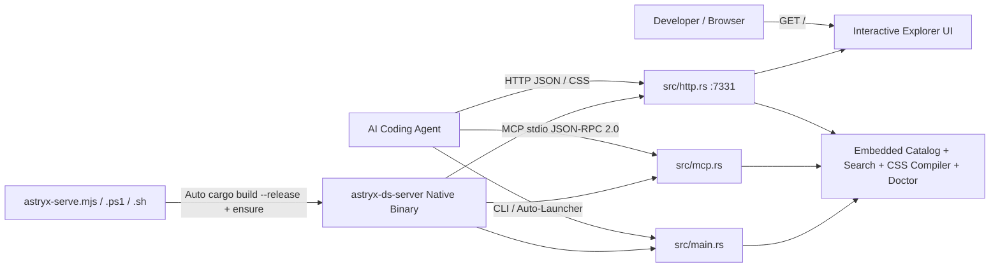

# Astryx Design System Skill — Native Rust Auto-Serving Engine

> **Meta's [Astryx](https://github.com/meta/astryx) Design System** implemented as a universal agentic skill in **Rei Skills** with an embedded, zero-dependency **native Rust server (`astryx-ds-server`)** providing automatic HTTP/REST serving, live theme CSS generation, an interactive Design System Explorer UI, native MCP JSON-RPC 2.0 over stdio, and a sub-millisecond CLI.

[](https://github.com/meta/astryx)
[](https://www.npmjs.com/package/@astryxdesign/core)
[-CE422B?style=flat-square&logo=rust)](rust-server/Cargo.toml)
[](https://github.com/meta/astryx/blob/main/LICENSE)

---

## What Is Included

Extracted directly from the authoritative [meta/astryx](https://github.com/meta/astryx) repository (`@astryxdesign/core@0.7.18`) and compiled directly into the Rust binary via `include_str!`:

| Domain | Count | Highlights |
| :--- | ---: | :--- |
| **Core Components** | **176** | `AppShell`, `Button`, `IconButton`, `Dialog`, `AlertDialog`, `Table`, `Card`, `Section`, `Stack`, `Grid`, `CommandPalette`, `ChatComposer`, `DateRangeInput`, `TreeList`, `TopNav`, `SideNav`, `Toast`, `Popover`, `Tooltip`, etc. |
| **Hooks** | **87** | `useToast`, `useLayer`, `useTheme`, `useFocusTrap`, `useHotkeys`, `useTableSortable`, `useTableFiltering`, `useTableSelection`, `useStreamingText`, `usePressFeedback`, etc. |
| **Utilities** | **9** | `Theme`, `MediaTheme`, `SyntaxTheme`, `InternationalizationProvider`, `createAnimator`, `createPanGesture`, `createReorderable`, `createDragToSnapPoints` |
| **Design Tokens** | **211** | All 13 StyleX token families (`color`, `spacing`, `size`, `border`, `focus`, `radius`, `shadow`, `duration`, `ease`, `typography`, `textSize`, `fontWeight`, `typeScale`) with light & dark values |
| **Official Themes** | **7** | `neutral`, `butter`, `chocolate`, `gothic` (dark-only), `matcha`, `stone`, `y2k` — each with 94–109 real OKLCH-resolved light/dark token overrides + live `/tokens.css` compiler |
| **Page Templates** | **58** | Dashboards, settings, AI chat, table pages, kanban, IDE, checkout wizard, login variants, file explorer, incident console, detail pages |
| **Design Guides** | **12** | `principles`, `theme`, `getting-started`, `color`, `spacing`, `elevation`, `shape`, `motion`, `styling-overview`, `icons`, `is-my-code-good`, `browser-support` |

---

## Architecture



### Why Native Rust (Zero External Crates)?

- **Zero external crates (`Cargo.toml` has no `[dependencies]`):** Compiles completely **offline** in a few seconds on Windows, macOS, and Linux — no `crates.io` fetch failures, no transitive dependency bloat.
- **Single self-contained ~1.8 MB binary:** Embeds the entire 1.1 MB Astryx catalog, RFC-8259 JSON parser/serializer, weighted fuzzy search engine, dynamic CSS theme compiler, static Astryx code auditor (`doctor`), multi-threaded HTTP/1.1 server, MCP JSON-RPC 2.0 stdio server, and interactive Web Explorer UI.
- **Automatic lifecycle (`ensure`):** Running the launcher with no arguments builds the release binary if missing or outdated, probes `http://127.0.0.1:7331/health`, and automatically spawns a detached background daemon only if it is not already running.

---

## Quick Start (Automatic Native Rust Serving)

### 1. Auto-Build & Auto-Serve (One Command)

```bash
# Cross-platform (recommended — works on Windows, macOS, Linux)
node skills/astryx-design-system/scripts/astryx-serve.mjs

# Or from repository root via npm script:
npm run astryx:serve

# Windows PowerShell directly:
./skills/astryx-design-system/scripts/astryx-serve.ps1

# macOS / Linux directly:
sh skills/astryx-design-system/scripts/astryx-serve.sh
```

Then open **`http://127.0.0.1:7331/`** in your browser to explore components, live-switch all 7 themes + Light/Dark mode, inspect CSS tokens, browse page templates, plan pages, and run the Code Doctor.

### 2. Run as a Native MCP Server (Claude Code / Cursor / Antigravity / Codex)

Add the snippet from [mcp.json](mcp.json) to your agent's MCP configuration:

```json
{
  "mcpServers": {
    "astryx-design-system": {
      "command": "node",
      "args": [
        "skills/astryx-design-system/scripts/astryx-serve.mjs",
        "mcp"
      ]
    }
  }
}
```

> In MCP mode, any first-run Rust compilation output is routed strictly to `stderr` so `stdout` remains clean JSON-RPC 2.0.

### 3. Direct CLI Usage (Zero Latency)

```bash
# Search everything (components, hooks, tokens, themes, templates, docs)
node skills/astryx-design-system/scripts/astryx-serve.mjs search "date picker"

# Full component API (props, defaults, best practices, WCAG a11y, JSX example)
node skills/astryx-design-system/scripts/astryx-serve.mjs component Button
node skills/astryx-design-system/scripts/astryx-serve.mjs component Table --json

# Plan a page (template + components + workflow)
node skills/astryx-design-system/scripts/astryx-serve.mjs build "incident triage console with table and drawer"

# Compile live CSS custom properties for any of the 7 themes
node skills/astryx-design-system/scripts/astryx-serve.mjs theme matcha --css --mode auto
node skills/astryx-design-system/scripts/astryx-serve.mjs theme gothic --css --mode dark

# Audit a React/TSX/CSS codebase against Astryx rules
node skills/astryx-design-system/scripts/astryx-serve.mjs doctor ./src
```

---

## HTTP API Overview

| Endpoint | Example | Description |
| :--- | :--- | :--- |
| `GET /` | `http://127.0.0.1:7331/` | Interactive Astryx Explorer Web UI |
| `GET /health` | `curl http://127.0.0.1:7331/health` | Health status, version, uptime |
| `GET /api/stats` | `curl http://127.0.0.1:7331/api/stats` | Catalog counts & upstream version |
| `GET /api/search` | `/api/search?q=modal&kind=component&limit=10` | Ranked keyword + fuzzy search |
| `GET /api/components` | `/api/components?category=Action` | Filterable list of 272 components & hooks |
| `GET /api/components/:name` | `/api/components/Button` | Full props, anatomy, a11y, best practices |
| `GET /api/tokens` | `/api/tokens?family=color` | All 211 tokens (light + dark values) |
| `GET /api/themes` | `/api/themes` | All 7 official themes |
| `GET /api/themes/:name/tokens.css` | `/api/themes/butter/tokens.css?mode=auto` | Live CSS variables stylesheet |
| `GET /api/templates` | `/api/templates?q=dashboard` | All 58 official page templates |
| `GET /api/docs/:slug` | `/api/docs/principles` | Core design & architecture guides |
| `GET /api/build` | `/api/build?idea=billing+settings` | Smart page template & component planner |
| `POST /api/doctor` | `POST {"filename":"App.tsx","code":"..."}` | Static Astryx rule compliance audit |

Full HTTP, MCP, and CLI documentation is in [references/rust-service.md](references/rust-service.md).

---

## Using Astryx in a React 19+ Application

```bash
npm install @astryxdesign/core @astryxdesign/theme-neutral @stylexjs/stylex
npm install -D @astryxdesign/cli
npx @astryxdesign/cli init
```

```tsx
// app/globals.css
@import '@astryxdesign/theme-neutral/fonts.css';
@import '@astryxdesign/core/reset.css';
@import '@astryxdesign/core/astryx.css';
@import '@astryxdesign/theme-neutral/theme.css';
```

```tsx
import {Theme} from '@astryxdesign/core/theme';
import {neutralTheme} from '@astryxdesign/theme-neutral/built';
import {AppShell} from '@astryxdesign/core/AppShell';
import {Stack} from '@astryxdesign/core/Stack';
import {Heading, Text} from '@astryxdesign/core/Text';
import {Button} from '@astryxdesign/core/Button';

export function ExamplePage() {
  return (
    <Theme theme={neutralTheme} mode="system">
      <AppShell>
        <Stack gap={4} padding={6} align="start">
          <Heading level={1}>Astryx Workspace</Heading>
          <Text>Accessible, themeable React 19 UI with zero styling lock-in.</Text>
          <Button label="Create project" variant="primary" />
        </Stack>
      </AppShell>
    </Theme>
  );
}
```

---

## Directory Structure

```text
skills/astryx-design-system/
├── SKILL.md                                  # Universal Rei Skills definition (validated)
├── README.md                                 # This documentation
├── mcp.json                                  # Ready-to-use MCP server configuration
├── references/
│   ├── components.md                         # All 272 components, hooks & utilities
│   ├── tokens.md                             # All 211 CSS custom properties (13 families)
│   ├── themes.md                             # All 7 official themes + usage guide
│   ├── principles-and-conventions.md         # 8 rules, naming conventions, StyleX v0.19
│   └── rust-service.md                       # Complete HTTP, MCP & CLI API reference
├── scripts/
│   ├── astryx-serve.mjs                      # Cross-platform auto-build + auto-serve shim
│   ├── astryx-serve.ps1                      # Windows PowerShell auto-launcher
│   ├── astryx-serve.sh                       # macOS / Linux POSIX auto-launcher
│   └── extract-astryx-data.mjs               # Upstream meta/astryx catalog sync generator
└── rust-server/
    ├── Cargo.toml                            # Zero-dependency Rust crate (Edition 2021)
    ├── data/astryx_catalog.json              # Extracted upstream Astryx catalog
    └── src/
        ├── main.rs                           # CLI + serve + ensure daemon + mcp entrypoint
        ├── json.rs                           # Zero-dependency RFC-8259 JSON parser/serializer
        ├── catalog.rs                        # Embedded catalog loader & typed domain models
        ├── search.rs                         # Ranked keyword/fuzzy search + build recommender
        ├── css.rs                            # Live CSS custom-property theme compiler
        ├── doctor.rs                         # Static Astryx code & project compliance auditor
        ├── http.rs                           # Multi-threaded HTTP/1.1 REST API + health probe
        ├── mcp.rs                            # Native MCP JSON-RPC 2.0 stdio server
        └── ui.rs                             # Embedded interactive Design System Explorer UI
```

---

## Development, Testing & Upstream Sync

### Run Rust Unit Tests & Release Build

```bash
cd skills/astryx-design-system/rust-server
cargo test
cargo build --release
```

### Sync with a Newer Upstream `meta/astryx` Release

```bash
git clone --depth 1 https://github.com/meta/astryx.git /tmp/astryx-upstream
node skills/astryx-design-system/scripts/extract-astryx-data.mjs /tmp/astryx-upstream
node skills/astryx-design-system/scripts/astryx-serve.mjs stats
```

### Troubleshooting

- **`cargo` not found:** Install the Rust toolchain via [rustup.rs](https://rustup.rs). No external crates are downloaded during compilation.
- **Port `7331` already in use:** Pass `--port <port>` (e.g., `node skills/astryx-design-system/scripts/astryx-serve.mjs ensure --port 7332`).
- **Stopping the background server:** On Windows: `Stop-Process -Name astryx-ds-server`; on macOS/Linux: `pkill astryx-ds-server`.

---

## Attribution & License

- **Upstream Design System:** [Meta Astryx (`meta/astryx`)](https://github.com/meta/astryx) — MIT License.
- **Skill & Native Rust Server:** Curated and engineered for **Rei Skills** ([Rootcastle Engineering & Innovation](https://www.rootcastle.com)) — MIT License.
